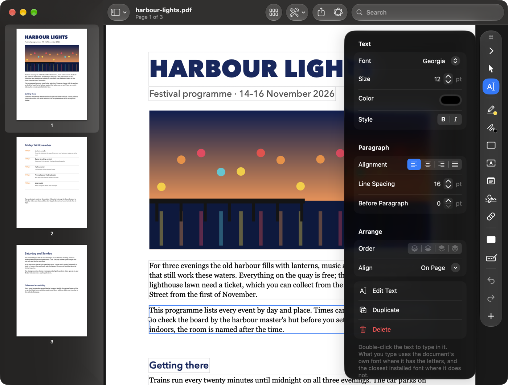
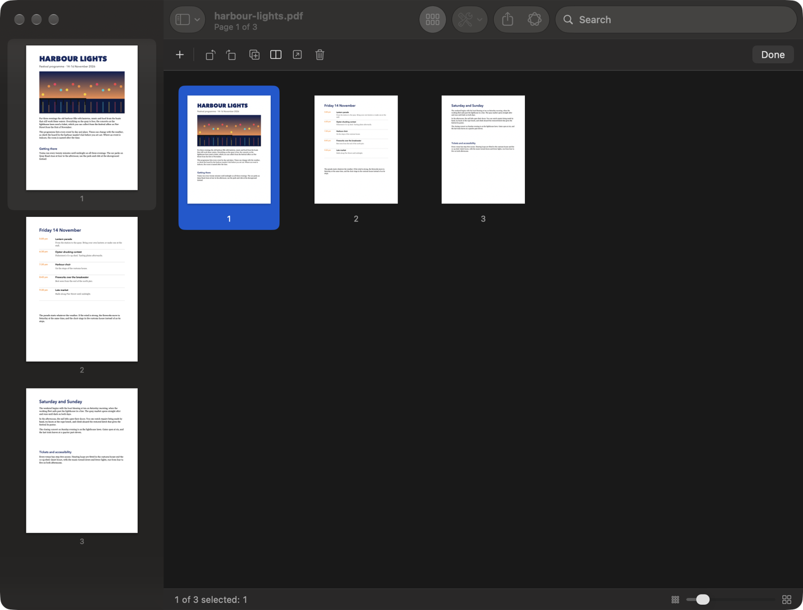
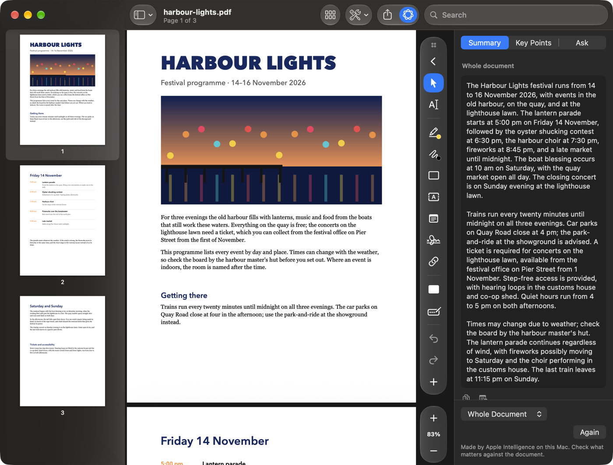
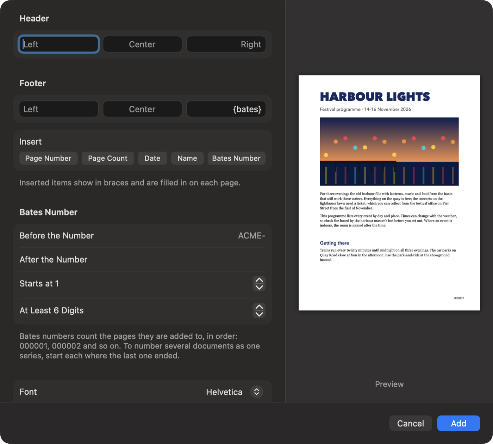

# Sheaf

A PDF editor for the Mac that looks and works like the apps that come with it. You can change the words and pictures already on a page, mark documents up, sign them, fill in and build forms, redact, reorganize pages, and convert files, all on your Mac with no account and nothing sent anywhere.

Sheaf is written in Swift and SwiftUI. The engine that reads and changes PDF files, SheafKit, is written from scratch for this app and has no third-party code in it.



## What it does

**Edit what is on the page.** Double-click a paragraph and type. Sheaf keeps the document's own font where it has the letters and falls back to the closest installed font where it doesn't. Paragraphs rewrap inside their box. The options panel changes font, size, color, bold and italic, alignment, line spacing and the space between paragraphs. Pictures can be moved, resized, turned, flipped, masked, adjusted and replaced, and text and pictures can be brought forward or sent back as in Pages.

**Mark up and sign.** Highlight, underline and strike out text. Add notes, text boxes, shapes, arrows, drawings, links, stamps and signatures. Signatures are kept encrypted in your keychain.

**Forms.** Fill in any form. Add text fields, checkboxes, radio buttons and pop-up menus to a form that has none, or let Sheaf find the blanks on a scanned paper form.

**Remove information for good.** Redaction removes the text, pictures and drawings under each mark from the file, not just from view. Remove Hidden Information takes out metadata, attachments, scripts, comments, bookmarks and other apps' private data before you share a document.

**Pages and whole documents.** Reorder, rotate, duplicate, split, extract and delete pages. You can also:
- merge PDFs and pictures, reduce file size and set a password;
- crop pages, and add watermarks, page backgrounds, headers and footers, and Bates numbers;
- recognize text in scans;
- compare two versions side by side.



**Convert.** Export to Word, Excel, rich text, web page, plain text, PDF/A and images. The Word, Excel, rich text, web page and plain text exports are in beta.

**Apple Intelligence.** On Macs that have it, Sheaf can sum up a document, list its key points and answer questions about it with the pages the answer comes from. It also offers Writing Tools in text you edit and Image Playground for new pictures. Super Resolution, Auto Crop and Remove Background work on pictures on a page. All of it runs on the Mac.



**Fits into macOS.** Sheaf is a document-based app, so window tabs, Versions, autosave, Open Recent and the title bar menu all work. It also supports:
- Shortcuts actions, Finder Quick Actions and the Services menu;
- importing from an iPhone or iPad, and from scanners;
- the Help Book;
- English and Russian.



## Status

Sheaf works day to day but is not released yet. [VERIFY.md](VERIFY.md) lists what still has to be checked by hand, and [RELEASING.md](RELEASING.md) lists what is needed to ship (signing, notarization, updates, the Mac App Store). [PLAN.md](PLAN.md) has the design, the roadmap and a log of decisions.

## Requirements

- macOS 26 or later. So far it has only run on macOS 27.
- Xcode 27, and [XcodeGen](https://github.com/yonaskolb/XcodeGen) to generate the Xcode project.
- Apple Intelligence features need a Mac that supports them, with Apple Intelligence turned on.

## Building

```bash
make project   # generate Sheaf.xcodeproj from project.yml
make run       # build and launch
make test      # engine tests
make corpus    # run the engine over every PDF that ships with macOS and Xcode
make strings   # sync the string catalog and apply the Russian translation
make help-book # rewrite the Help Book from Scripts/make-help.py
make release   # a disk image; see RELEASING.md for signing and notarizing
```

The project builds unsigned for running locally. No signing identities, team IDs or keys are kept in the repository. `Scripts/release.sh` takes them from the environment.

`Scripts/snapshot.sh <dir> [files]` launches the debug build on copies of the given files and saves a PNG of each window. The flags it accepts are listed at the top of `Sheaf/App/DebugSnapshot.swift`.

## Layout

- `Sheaf/` is the app: SwiftUI, with AppKit where it is needed.
- `Packages/SheafKit/` is the PDF engine: parser, writer, content editing, fonts, forms, redaction and conversion, with its tests and fixture PDFs.
- `Scripts/` holds the build, release, help and translation scripts.
- `project.yml` defines the Xcode project. `Sheaf.xcodeproj` is generated and not committed.

## Privacy

Sheaf has no accounts, servers, analytics or crash reporting. It runs in the macOS sandbox without network access, and documents are opened, changed and saved on your Mac. Two things involve Apple, and the help page "Sheaf and Your Privacy" covers them:
- Super Resolution's model is downloaded from Apple once, by macOS, after you agree.
- Writing Tools and Image Playground are Apple's own. They follow your Apple Intelligence settings, which may allow Private Cloud Compute or ChatGPT.

## License

Copyright © 2026 Valery Burtsev.

Sheaf is free software: you can redistribute it and/or modify it under the terms of the GNU General Public License as published by the Free Software Foundation, either version 3 of the License, or (at your option) any later version. It is distributed in the hope that it will be useful, but without any warranty; without even the implied warranty of merchantability or fitness for a particular purpose. See [LICENSE](LICENSE) for the full text.

Sheaf includes no third-party code, fonts or other assets. It uses only Apple's system frameworks. The sRGB color profile written into PDF/A files comes from macOS when the file is made. The tables of standard PDF encodings and glyph names are written out from the PDF specification.

Contributions are welcome; see [CONTRIBUTING.md](CONTRIBUTING.md).

Adobe and Acrobat are trademarks of Adobe Inc. Apple, Mac, macOS, Pages, Preview, Apple Intelligence and other Apple product names are trademarks of Apple Inc. Sheaf is an independent project and is not affiliated with or endorsed by either company.
